# JEVO Real Logic / Backend Handoff

Sep 25, 2026 · @caesar

## 0. Context & Basis

This handoff is written without direct access to the JEVO repository (`docs/`, `web/src/data/mock-agent-state.ts`, `web/src/schemas/`, `web/src/types/`) — no repo connector is available in this session, and none of the registry's connectors cover source-control access. Everything below is derived from two sources instead:

1. **The JEVO Protocol dev brief** (the full product/UX brief already shared in this chat).
2. **The frontend reference files already built in this chat** — `landing.html` and `app.html` (the consolidated design reference), plus the six original page docs (stock detail, pairing marketplace, pairing detail, autonomous launch, agent memory, admin panels). These encode a consistent, real fixture shape: rank/previous-rank/score/decision per asset, a four-field pairing thesis (why stock / why meme / why pair / why now) with component scores, a six-stage launch tracker with a six-step T-24H checklist, and a rank+score history with a decision log.

**Treat every field name in this document as a proposal, not a fact pulled from `mock-agent-state.ts`.** Before BACKEND 01 (schema) starts, diff Section 4's domain types against the real fixture file and rename anything that collides, so the API doesn't force an avoidable breaking change on the frontend Codex/GPT already built. If you connect a GitHub source to this chat, I can do that reconciliation pass directly instead of leaving it as a manual step.

## 1. Executive Architecture

JEVO is one autonomous agent, not a feature list. The backend's entire job is to run its loop reliably, persist every decision it makes, and publish the result fast enough that the frontend never has to guess or fake a number. Jev is the decision layer inside that loop — it is never called directly by the frontend, and it never touches a wallet.

| Loop stage | What happens                                                                                                     | Backend component        | Primary tech                      |
| ---------- | ---------------------------------------------------------------------------------------------------------------- | ------------------------ | --------------------------------- |
| Observe    | Pull Stock Token, market, narrative and social data; normalize into features                                     | Scanner jobs             | BullMQ workers, provider adapters |
| Decide     | Jev evaluates changed assets; returns a typed decision                                                           | Decision Engine          | `JevProvider` + Zod               |
| Rank       | Deterministic weighting turns features + Jev output into an Opportunity Score                                    | Ranking Engine           | Plain TS, Postgres                |
| Pair       | Independent thesis pass turns a ranked stock into a stock × meme candidate                                       | Pairing Engine           | Plain TS + Jev, Postgres          |
| Act (held) | A qualified pair becomes a launch candidate; policy checks run; execution stays blocked pending a human/guardian | Launch Candidate service | Postgres, no signing yet          |

Every arrow above is also a write: each stage persists its output before the next stage reads it, and each write emits a protocol event (Section 12) so the frontend updates without polling. The frontend's `mockAgentState` becomes, after this phase, a read model built from exactly these tables — nothing the UI shows should exist only in memory.

One architectural rule carries through the whole document: **domain/protocol state lives in Postgres, never in Zustand.** Zustand may hold UI-only state (which tab is open, filter text, modal visibility). Anything the agent decided is server state, fetched via TanStack Query and pushed via SSE (Section 14–15).

## 2. Recommended Repository Structure

**One backend service, not two.** Fold the API into `worker/` rather than splitting `api/` + `worker/`. Reasoning: at MVP scale a single Node process can register HTTP routes and BullMQ workers together; splitting now buys no real isolation (both would share the same Postgres and Redis anyway) and costs an extra deploy target, an extra env-var set, and cross-service request hops for zero benefit. The split is still available later for free — `src/api/` and `src/jobs/` are already separate folders, so extracting one into its own service is a copy-and-deploy, not a rewrite.

```
JEVO/
├─ docs/                     # brief + design references (unchanged)
├─ web/                      # existing Next.js frontend — untouched by this phase
├─ worker/                   # NEW — the entire backend (API + scanner + jobs + Jev)
│  ├─ src/
│  │  ├─ config/            # env loading + validation (Section 22)
│  │  ├─ db/                # drizzle schema + client (Section 5)
│  │  ├─ providers/         # MarketDataProvider, StockTokenProvider, … (Section 6)
│  │  ├─ jev/               # JevProvider adapter + DecisionEngine (Section 7)
│  │  ├─ agent/             # the cycle orchestrator (Section 9)
│  │  ├─ ranking/           # scoring + rank_history writes (Section 8)
│  │  ├─ pairing/           # pairing engine (Section 10)
│  │  ├─ memory/            # memory-event read/write helpers (Section 11)
│  │  ├─ events/            # protocol event bus + SSE fan-out (Section 12, 14)
│  │  ├─ jobs/              # BullMQ queue + worker definitions (Section 9)
│  │  ├─ api/               # HTTP routes (Section 13)
│  │  └─ observability/     # logger, metrics (Section 17)
│  ├─ drizzle/               # SQL migrations
│  ├─ package.json
│  └─ Dockerfile
├─ contracts/                # exists, stays empty until Section 21's later phase
└─ pnpm-workspace.yaml       # web/ + worker/ as workspace packages
```

**Monorepo tooling:** plain pnpm workspaces. No Turborepo/Nx yet — two packages with almost no shared code between them doesn't need a build-graph tool; revisit only if `web/` and `worker/` start sharing a types package and build times become a real problem.

**Shared types:** add a third workspace package, `packages/protocol-types/`, holding only the Zod schemas + inferred TS types from Section 4. Both `web/` and `worker/` import from it. This is the one piece of structure worth adding up front — it's exactly what lets Section 15's frontend migration happen without a UI rewrite, because the frontend's types and the API's response types are the same source file, not two hand-kept-in-sync copies.

## 3. Data Flow

```mermaid
flowchart LR
  P[Providers] -->|fetch| N[Normalizer]
  N -->|BullMQ job, async| AC[Agent Cycle]
  AC -->|call, sync w/ timeout| JEV[Jev Decision]
  JEV --> SC[Scoring / Ranking]
  SC -->|transaction| DB[(Postgres)]
  DB -->|after commit| EV[Event Bus]
  EV -->|push| API[API + SSE]
  API -->|cache patch| TQ[TanStack Query]
  TQ --> UI[React UI]
```



**Sync vs async, explicitly:**

- Provider fetch → normalize → Jev call → scoring → DB write all happen **inside one BullMQ job**, off the request path entirely. Nothing a browser does ever triggers this chain directly.
- The Jev call inside that job is a synchronous HTTP request with a hard timeout (Section 16); the job holds until it returns or times out, it doesn't fan out.
- The DB write is one transaction per cycle-step (Section 9's boundaries), not one write per field.
- Event publish happens **after** the transaction commits, never before — an event must never describe state that isn't durably saved yet.
- API reads are plain synchronous Postgres queries; SSE is a push on top of the same event bus, not a second data path. If SSE drops, a GET on the relevant endpoint returns the identical shape — the frontend can always fall back to polling without touching the response model.
- TanStack Query either refetches the affected query key or patches its cache directly from the SSE payload (Section 15); React only ever renders from that cache, never from a raw socket message.

## 4. Domain Types

Live in `packages/protocol-types/src/*.ts` as Zod schemas with inferred types (`z.infer<typeof X>`), so runtime validation and compile-time types can never drift apart. Every Jev response and every API response is parsed through these before anything else touches it.

```typescript
// --- core asset + observation ---
interface StockAsset {
  symbol: string; // "NVDA" — matches frontend rows' `a`
  name: string; // "NVIDIA" — matches frontend rows' `n`
  stockTokenAddress: string; // canonical Robinhood Chain contract
  active: boolean;
}

interface MarketSnapshot {
  id: string;
  symbol: string;
  price: number;
  volume24h: number;
  volatility: number;
  capturedAt: string; // ISO timestamp
  source: string; // provider name
}

interface SignalObservation {
  id: string;
  symbol: string;
  kind: "narrative" | "social" | "news" | "onchain";
  magnitude: number; // normalized 0–100
  label: string; // "AI infrastructure narrative accelerating"
  capturedAt: string;
  source: string;
}

// --- agent runtime + cycles ---
interface AgentRuntime {
  status: "online" | "paused" | "degraded";
  currentCycleId: string | null;
  currentOperation: string; // "Scanning US Stock Tokens"
  lastFullScanAt: string | null;
  nextFullScanAt: string | null;
}

interface AgentCycle {
  id: string; // e.g. "9841" — matches frontend's `cycle`
  kind: "delta" | "ranking" | "full" | "narrative";
  startedAt: string;
  completedAt: string | null;
  assetsScanned: number;
  signalsProcessed: number;
  status: "running" | "completed" | "failed";
}

// --- Jev decisions + scoring ---
interface JevDecision {
  id: string;
  cycleId: string;
  symbol: string;
  decision: "promote" | "hold" | "demote"; // frontend's `dec`, lowercased
  confidence: number; // 0–1
  signals: string[]; // short evidence labels, not raw text
  modelVersion: string; // e.g. "jev-2026-08"
  createdAt: string;
}

interface OpportunityScore {
  symbol: string;
  cycleId: string;
  marketMomentum: number;
  narrativeMomentum: number;
  socialVelocity: number;
  culturalRelevance: number;
  memeCompatibility: number;
  cryptoAdjacency: number;
  pairCompatibility: number;
  score: number; // final weighted 0–100, frontend's `s`
}

interface RankSnapshot {
  cycleId: string;
  symbol: string;
  rank: number; // frontend's `cur`
  previousRank: number | null; // frontend's `prev`
  score: number;
  recordedAt: string;
}

// --- pairing ---
interface PairingCandidate {
  id: string;
  symbol: string;
  memeSymbol: string; // "$GPU"
  thesis: {
    whyStock: string;
    whyMeme: string;
    whyPair: string;
    whyNow: string;
  };
  components: {
    narrative: number;
    cultural: number;
    meme: number;
    crypto: number;
    timing: number;
    stockRelevance: number;
  };
  pairingScore: number; // frontend's pairing `score`
}

interface PairingDecision {
  id: string;
  pairingCandidateId: string;
  decision: "strong_pair" | "proposed" | "rejected";
  confidence: number;
  createdAt: string;
}

type PairingLifecycle =
  | "detected"
  | "analyzed"
  | "proposed"
  | "curated"
  | "launch_candidate"
  | "launched"
  | "archived";

// --- launch (no execution yet — see Section 21) ---
interface LaunchCandidate {
  id: string; // "LC-204"
  pairingCandidateId: string;
  stage:
    | "candidate_selected"
    | "narrative_validation"
    | "pairing_validation"
    | "contract_preparation"
    | "final_policy_check"
    | "ready";
  readiness: "preparing" | "ready" | "paused";
  checksPassed: number; // e.g. 6
  checksTotal: number; // e.g. 8
  stageDeadlineAt: string; // drives the T-minus clock
  transactionStatus: "not_submitted"; // only value possible this phase
}

// --- memory + events ---
interface MemoryEvent {
  id: string;
  subjectType: "asset" | "pairing" | "launch";
  subjectId: string;
  cycleId: string;
  previousState: Record<string, unknown>;
  observedChange: string;
  decision: string | null;
  currentState: Record<string, unknown>;
  evidenceRefs: string[]; // JevDecision / SignalObservation ids
  recordedAt: string;
}

interface ProviderHealth {
  provider: string;
  status: "healthy" | "degraded" | "down";
  latencyMs: number;
  lastSuccessAt: string | null;
}

interface ProtocolEvent {
  eventId: string;
  eventType: string; // catalogue in Section 12
  cycleId: string | null;
  subjectType: string | null;
  subjectId: string | null;
  payload: Record<string, unknown>;
  schemaVersion: number;
  createdAt: string;
}
```

Field names above intentionally echo what the frontend fixtures already use (`a`, `n`, `cur`, `prev`, `s`, `dec`) at the API boundary so the migration in Section 15 is a data-source swap, not a rename. Reconcile against the real `mock-agent-state.ts` per Section 0 before treating these as final.

## 5. Database Schema

PostgreSQL, one schema, Drizzle for migrations (lighter than Prisma, generates plain SQL you can read in review). Deliberately under-normalized where a `jsonb` column is cheaper than a join table for MVP speed — thesis text, component scores and event payloads are jsonb, not five extra tables.

**Core protocol tables**

| Table                 | Purpose                                                    | Key columns                                                                                         | PK                     | Unique / indexes                                | Retention              |
| --------------------- | ---------------------------------------------------------- | --------------------------------------------------------------------------------------------------- | ---------------------- | ----------------------------------------------- | ---------------------- |
| `assets`              | Canonical Stock Token registry                             | symbol, name, stock_token_address, active                                                           | symbol                 | unique(stock_token_address)                     | permanent              |
| `market_snapshots`    | Raw price/volume/volatility polls                          | id, symbol, price, volume_24h, volatility, captured_at, source                                      | id                     | idx(symbol, captured_at desc)                   | 90d raw → daily rollup |
| `signal_observations` | Normalized narrative/social/news/onchain signals           | id, symbol, kind, magnitude, label, captured_at, source                                             | id                     | idx(symbol, captured_at desc), idx(kind)        | 90d                    |
| `agent_cycles`        | One row per scan cycle                                     | id, kind, started_at, completed_at, assets_scanned, signals_processed, status                       | id                     | — (id is minted once, Section 16)               | permanent              |
| `jev_decisions`       | Every Jev call's structured result                         | id, cycle_id, symbol, decision, confidence, signals jsonb, model_version, created_at                | id                     | **unique(cycle_id, symbol)**                    | permanent              |
| `opportunity_scores`  | 7 components + final score per symbol/cycle                | cycle_id, symbol, market_momentum…pair_compatibility, score                                         | (cycle_id, symbol)     | —                                               | permanent              |
| `rank_history`        | Ranked position per symbol per cycle — the memory backbone | cycle_id, symbol, rank, previous_rank, score, recorded_at                                           | **(cycle_id, symbol)** | idx(symbol, cycle_id desc), idx(cycle_id, rank) | permanent              |
| `pairing_candidates`  | A proposed stock × meme thesis                             | id, symbol, meme_symbol, thesis jsonb, components jsonb, pairing_score, lifecycle_state, created_at | id                     | idx(symbol), idx(lifecycle_state)               | permanent              |
| `pairing_decisions`   | Jev's own verdict on a candidate                           | id, pairing_candidate_id, decision, confidence, created_at                                          | id                     | idx(pairing_candidate_id, created_at desc)      | permanent              |

**Supporting tables**

| Table                   | Purpose                                              | Key columns                                                                                                                                    | PK       | Unique / indexes                                      | Retention  |
| ----------------------- | ---------------------------------------------------- | ---------------------------------------------------------------------------------------------------------------------------------------------- | -------- | ----------------------------------------------------- | ---------- |
| `pairing_history`       | Lifecycle transition log                             | id, pairing_candidate_id, from_state, to_state, actor, transitioned_at                                                                         | id       | idx(pairing_candidate_id, transitioned_at)            | permanent  |
| `launch_candidates`     | A pairing that entered the 24h cycle                 | id ("LC-204"), pairing_candidate_id, stage, readiness, checks_passed, checks_total, stage_deadline_at, transaction_status                      | id       | unique(pairing_candidate_id) where status != archived | permanent  |
| `launch_cycles`         | T-24H…T-00 checklist rows                            | id, launch_candidate_id, stage_label, description, status, completed_at                                                                        | id       | idx(launch_candidate_id, stage_label)                 | permanent  |
| `memory_events`         | "What changed and why" — what Section 11 reads from  | id, subject_type, subject_id, cycle_id, previous_state jsonb, observed_change, decision, current_state jsonb, evidence_refs jsonb, recorded_at | id       | idx(subject_type, subject_id, recorded_at desc)       | permanent  |
| `protocol_events`       | Append-only event log driving SSE + audit            | event_id, event_type, cycle_id, subject_type, subject_id, payload jsonb, schema_version, created_at                                            | event_id | idx(created_at desc), idx(event_type), idx(cycle_id)  | 30–60d hot |
| `provider_runs`         | Health/latency log per provider poll                 | id, provider, status, latency_ms, error, ran_at                                                                                                | id       | idx(provider, ran_at desc)                            | 14d        |
| `agent_config_versions` | Versioned ranking weights + Jev model/prompt version | id, weights jsonb, jev_model_version, jev_prompt_version, active_from, created_by                                                              | id       | — (small, keep forever)                               | permanent  |

**Why the two bolded uniqueness constraints matter more than the rest:** `jev_decisions(cycle_id, symbol)` and `rank_history(cycle_id, symbol)` are the two constraints that directly stop the failure mode the brief calls out by name — a retried or double-fired cycle writing the same symbol twice into the same cycle. Every write to either table should be an upsert (`ON CONFLICT (cycle_id, symbol) DO UPDATE`) keyed on that constraint, never a bare insert. Section 16 covers the cycle-ID minting that makes `cycle_id` itself safe to reuse as a key.

## 6. Provider Interfaces

Business logic (`agent/`, `ranking/`, `pairing/`) only ever imports these four interfaces, never a vendor SDK directly. Every concrete implementation lives in `providers/<kind>/<vendor>.ts` and returns Section 4's normalized types — swapping a vendor is one new file plus one config flag, not a business-logic change.

```typescript
interface MarketDataProvider {
  getSnapshot(symbol: string): Promise<MarketSnapshot>;
  getSnapshots(symbols: string[]): Promise<MarketSnapshot[]>; // batched poll
}

interface StockTokenProvider {
  getCanonicalAddress(symbol: string): Promise<string | null>;
  getOnchainPrice(
    address: string,
  ): Promise<{ price: number; capturedAt: string }>; // Chainlink feed read
}

interface NarrativeProvider {
  getSignals(symbol: string, since: string): Promise<SignalObservation[]>; // kind: "narrative" | "news"
}

interface SocialProvider {
  getVelocity(symbol: string, since: string): Promise<SignalObservation[]>; // kind: "social"
}
```

**Provider selection** is one line in `config/providers.ts` (`MARKET_PROVIDER=polygon`, `NARRATIVE_PROVIDER=...`), read once at boot — not scattered `if (vendor === ...)` checks through the codebase.

**Every call through these interfaces is wrapped**, not called raw: the wrapper times the call, catches errors, and writes one row to `provider_runs` (Section 5) regardless of outcome. This is what powers both the admin Providers panel and the circuit-breaking behavior in Section 16 — health tracking isn't a separate system bolted on later, it's the only way these interfaces are ever called.

**Pons state** (existing stock-paired-token markets) is deliberately not a fifth interface here — it only matters once Section 21's launch phase begins, and forcing its shape in now would be guessing at an integration that doesn't exist yet.

## 7. Jev Integration

Jev is called from exactly one place: `worker/src/jev/JevProvider.ts`. Its API key lives only in the worker's environment and is never read by, or proxied through, `web/`. `web/` never imports anything from `jev/`.

```typescript
interface JevProvider {
  evaluateChoice<T extends string>(
    input: ChoiceInput<T>,
  ): Promise<ChoiceResult<T>>;
  evaluateScore(input: ScoreInput): Promise<ScoreResult>;
  evaluateNoul(input: NoulInput): Promise<NoulResult>; // name as given in the brief — unconfirmed shape, see Section 22
}

interface ChoiceInput<T> {
  context: Record<string, unknown>;
  options: T[];
}
interface ChoiceResult<T> {
  choice: T;
  confidence: number;
  signals: string[];
}

interface ScoreInput {
  context: Record<string, unknown>;
  dimensions: string[];
}
interface ScoreResult {
  scores: Record<string, number>;
  confidence: number;
}
```

`ChoiceResult`/`ScoreResult` are the two primitives actually used by Sections 8–10 (`evaluateChoice` for promote/hold/demote and for pairing verdicts, `evaluateScore` for the seven opportunity-score components). `evaluateNoul`'s real input/output isn't guessed at here — inventing fields for a method whose semantics aren't confirmed would just create a second thing to unwind later.

**`DecisionEngine`** sits on top and is what the rest of the codebase actually calls — nothing outside `jev/` calls `JevProvider` directly:

```typescript
class DecisionEngine {
  constructor(private jev: JevProvider) {}

  async decideForAsset(
    features: NormalizedFeatures,
    cycleId: string,
  ): Promise<JevDecision> {
    const raw = await this.jev.evaluateChoice({
      context: features,
      options: ["promote", "hold", "demote"],
    });
    const parsed = JevChoiceResultSchema.parse(raw); // throws on malformed output
    return {
      id: crypto.randomUUID(),
      cycleId,
      symbol: features.symbol,
      decision: parsed.choice,
      confidence: parsed.confidence,
      signals: parsed.signals, // short labels only
      modelVersion: this.jev.version,
      createdAt: new Date().toISOString(),
    };
  }
}
```

**What gets persisted vs discarded, explicitly:** structured inputs (the `context` object sent), structured evidence (`signals`, a list of short labels), the decision/classification, the confidence, the model/provider version, the timestamp, and the cycle ID — all of it goes into `jev_decisions`. **Anything resembling free-text chain-of-thought in a raw Jev response is stripped in the adapter before the object ever reaches a Zod schema or a database call** — not filtered out later, never persisted at all. The UI's "decision trace" (Section 12) is built from these stored fields, never from re-querying Jev for an explanation after the fact.

## 8. Decision / Scoring Engine

Four distinct stages, each with a different owner — conflating them is exactly how a scoring system quietly turns into a black box:

1. **Raw provider features** — whatever `market_snapshots` / `signal_observations` contain, untouched.
2. **Normalized features** — deterministic code turns raw numbers into comparable 0–100 inputs (a price-momentum calculation, a signal-magnitude rate of change). No Jev call yet.
3. **Jev evaluation** — for the components that are inherently qualitative, `DecisionEngine.evaluateScore()` sends the normalized context and gets back a 0–100 judgment per dimension.
4. **Deterministic weighting** — plain arithmetic combines every component (Jev-sourced or not) into the one final Opportunity Score.

| Component          | Source        | Why                                                                           |
| ------------------ | ------------- | ----------------------------------------------------------------------------- |
| Market Momentum    | Deterministic | Price/volume/volatility deltas — pure math                                    |
| Social Velocity    | Deterministic | Rate of change of signal magnitude over time — pure math                      |
| Narrative Momentum | Jev           | Judging whether a narrative is _accelerating and significant_ isn't a formula |
| Cultural Relevance | Jev           | Inherently qualitative                                                        |
| Meme Compatibility | Jev           | Inherently qualitative                                                        |
| Crypto Adjacency   | Jev           | Judging fit with crypto-native culture isn't a formula                        |
| Pair Compatibility | Jev           | Whether the asset is pairing-ready right now is a judgment call               |

```typescript
// deterministic weighting — the ONLY place the final score is computed
function computeOpportunityScore(
  c: OpportunityComponents,
  weights: ScoreWeights,
): number {
  return (
    c.marketMomentum * weights.marketMomentum +
    c.narrativeMomentum * weights.narrativeMomentum +
    c.socialVelocity * weights.socialVelocity +
    c.culturalRelevance * weights.culturalRelevance +
    c.memeCompatibility * weights.memeCompatibility +
    c.cryptoAdjacency * weights.cryptoAdjacency +
    c.pairCompatibility * weights.pairCompatibility
  ); // weights sum to 1.0, read from agent_config_versions — tunable without a redeploy
}
```

Jev supplies five of seven **component** judgments; it never computes the final score itself, and the weights it's blended with live in a versioned config table, not a prompt. That's the concrete answer to "don't build a black box controlled entirely by an LLM" — the blend is auditable arithmetic, and which weight version produced a given score is always recoverable from `agent_config_versions`.

**This is not a return prediction, and the API/UI must never imply one.** The Opportunity Score measures how well-suited an asset is, _right now_, for a stock-native meme pairing — narrative timing, cultural legibility, crypto-native fit. It says nothing about where the stock's price goes next, and no field in Section 4 should ever be renamed or reframed to suggest otherwise (matches the brief's banned-language list in the product doc).

## 9. Agent Cycle

```
 1. Mint cycle_id — advisory lock + INSERT INTO agent_cycles (status='running'). This single mint is
    the whole idempotency story (Section 16); every later step keys off this id, never a new one.
 2. Acquire current universe — SELECT * FROM assets WHERE active
 3. Collect provider observations — parallel calls through the four Section 6 interfaces, each wrapped
    + health-logged to provider_runs
 4. Normalize features — deterministic, Section 8 stage 2
 5. Diff against the previous cycle's opportunity_scores per symbol
 6. Detect meaningful deltas — skip symbols with no material change (cost + rate-limit control)
 7. Request Jev evaluation ONLY for changed symbols — DecisionEngine.decideForAsset() + evaluateScore()
 8. Calculate opportunity scores — deterministic weighting, Section 8 stage 4
 9. Rank assets — order by score desc
10. Calculate rank deltas — compare to each symbol's prior rank_history row
11. Identify pairing candidates — assets that crossed a promote/rank threshold (Section 10's trigger)
12. Evaluate pairing theses for those candidates — PairingEngine.evaluate()
13. Persist — upsert decisions, scores, rank_history, pairing_candidates (Section 5's constraints)
14. Write memory events — one memory_events row per meaningfully-changed subject
15. Publish protocol events — after each write's transaction commits, never before, never batched to the end
16. Mark agent_cycles.status='completed', schedule the next cycle (Section 9's scan frequencies)
```

**Transaction boundaries — several small transactions, not one giant one:**

- **TX1**: mint the cycle row alone, committed immediately — the cycle formally exists before anything else touches it.
- **TX2** (per asset, or batched in small groups): that symbol's `jev_decisions` + `opportunity_scores` + `rank_history` upserts together.
- **TX3**: `pairing_candidates` + `pairing_decisions` writes for whichever symbols were identified.
- **TX4**: `memory_events` writes.
- **TX5**: mark the cycle `completed`.

A single all-or-nothing transaction for the whole cycle is deliberately avoided: at 40+ assets it would hold locks far too long, and a crash at asset 38 would silently discard 37 good decisions instead of leaving them committed. Small upsert-keyed transactions mean a retried job resumes cleanly — it re-processes only what didn't commit, not the whole cycle.

**Idempotency, in brief** (full failure-mode table in Section 16): the cycle mint in step 1 is the only place a new `cycle_id` is ever created; every other write in the cycle is an upsert keyed on `(cycle_id, symbol)`, so re-running the same job (BullMQ retry, a duplicate trigger) either no-ops or overwrites with the same values — it can never produce a second rank for the same symbol in the same cycle.

## 10. Pairing Engine

**Rank #1 does not mean pairing #1.** The trigger for entering this engine is "crossed a promote/rank threshold this cycle" (e.g. top 10, or newly promoted) — not "is currently #1." Multiple qualified stocks get evaluated and proposed in the same cycle, sorted by their own pairing score, independent of stock rank order — this is exactly what `app.html`'s Pairing Marketplace already shows (NVDA, TSLA and GME proposed side by side, ordered by pairing score, not stock rank), so the design and this engine already agree on the shape.

```
qualified stock (crossed threshold this cycle)
  → retrieve meme concept candidates
  → Jev evaluates an independent thesis per candidate
  → deterministic factor scoring
  → candidate comparison (best → primary, rest → alternates)
  → proposal written (lifecycle_state = 'proposed')
  → human curation (MVP: admin approve / edit / reject)
  → launch candidate (Section 9's pipeline)
```

**Meme concepts are retrieved, not freely invented by Jev.** A small curated `meme_concepts` table (name, tags, notes — team-maintained, not agent-written) is queried for candidates whose tags overlap the stock's current top narrative signals; Jev's job is to evaluate and score 2–4 _existing_ candidates, not to originate a brand-new token name unsupervised. This is a deliberate control point: it's what makes the brief's "prohibited content" launch check (Section 20's checklist) actually checkable, instead of trying to content-moderate arbitrary LLM output after the fact.

```typescript
async function evaluatePairing(
  stock: StockAsset,
  concept: MemeConcept,
): Promise<PairingCandidate> {
  const thesis = await jev.evaluateChoice({
    context: { stock, concept, narrativeSignals },
    options: ["strong_pair", "proposed", "rejected"],
  });
  const components = await jev.evaluateScore({
    context: { stock, concept },
    dimensions: [
      "narrative",
      "cultural",
      "meme",
      "crypto",
      "timing",
      "stockRelevance",
    ],
  });
  return {
    id: crypto.randomUUID(),
    symbol: stock.symbol,
    memeSymbol: concept.symbol,
    thesis: buildThesisText(thesis, components), // whyStock / whyMeme / whyPair / whyNow
    components: components.scores,
    pairingScore: computePairingScore(components.scores, weights), // deterministic, same pattern as Section 8
  };
}
```

All candidates for a stock are persisted (not just the winner) — that's what powers the frontend's "alternative concepts" list. `lifecycle_state` (Section 4's `PairingLifecycle`) moves the primary candidate forward; alternates stay at `proposed` unless an operator picks a different one, which is a rejection-of-primary + promotion-of-alternate, logged in `pairing_history`, not a silent overwrite.

## 11. Memory

**"Current state" is never its own mutable row.** It's always derived by reading the latest row per subject from the authoritative tables — `rank_history` for rank, `opportunity_scores` for score, `jev_decisions` for the latest decision, `pairing_candidates.lifecycle_state` / `launch_candidates.stage` for pairing/launch state. `memory_events` is a **derived, denormalized narrative log** written _after_ those authoritative tables already committed (Section 9 step 14) — if it were ever lost, current state is still fully reconstructable without it.

```typescript
async function getCurrentAssetState(symbol: string) {
  const [rank, score, decision] = await Promise.all([
    db.rankHistory.findLatest(symbol), // ORDER BY cycle_id DESC LIMIT 1
    db.opportunityScores.findLatest(symbol),
    db.jevDecisions.findLatest(symbol),
  ]);
  return {
    rank: rank.rank,
    previousRank: rank.previousRank,
    score: score.score,
    decision: decision.decision,
  };
}
```

**Two different reads power two different frontend views**, and conflating them would make the memory chart lie:

- The **history chart** (rank + score over time, `app.html`'s Memory view) reads a numeric time series straight from `rank_history` ⁄ `opportunity_scores`, one row per cycle — it is never built from `memory_events`.
- The **decision log** ("NVDA promoted #04 → #01") reads `memory_events` directly, ordered by `recorded_at desc` — it is a narrative, not a series, and is never plotted.

Each `memory_events` row stores `previousState` / `currentState` as small jsonb snapshots (just the fields that changed, not a full entity dump) plus `evidenceRefs` — ids pointing back into `jev_decisions` / `signal_observations`, so "why did this change" is always one join away, never re-asked of Jev after the fact.

## 12. Events

Every event shares Section 4's `ProtocolEvent` envelope and is written to `protocol_events` in the same transaction as the state change it describes, then published to the event bus — never the other way around (Section 3's rule: an event never describes state that isn't durably saved yet).

| Event                              | Fires when                                               | subjectType |
| ---------------------------------- | -------------------------------------------------------- | ----------- |
| `AGENT_SCAN_STARTED`               | Cycle step 1, right after the cycle_id mints             | cycle       |
| `ASSET_ANALYZED`                   | Step 4, normalized features ready for one asset          | asset       |
| `JEV_DECISION_COMPLETED`           | Step 7, Jev returned a decision for one asset            | asset       |
| `RANKING_UPDATED`                  | Steps 9–10, full ranking recomputed                      | cycle       |
| `ASSET_PROMOTED` ⁄ `ASSET_DEMOTED` | A symbol's decision is promote/demote this cycle         | asset       |
| `PAIRING_PROPOSED`                 | New `pairing_candidates` row written                     | pairing     |
| `PAIRING_UPDATED`                  | `lifecycle_state` changes (curation, alternate promoted) | pairing     |
| `LAUNCH_SELECTED`                  | New `launch_candidates` row created                      | launch      |
| `COUNTDOWN_STARTED`                | First `launch_cycles` stage begins                       | launch      |
| `CYCLE_FAILED`                     | Cycle errors out (Section 16)                            | cycle       |
| `LAUNCH_EXECUTED`, `TX_CONFIRMED`  | **Deferred — not emitted this phase** (Section 21)       | —           |

Example payload for `RANKING_UPDATED`:

```json
{
  "eventId": "a3f1...",
  "eventType": "RANKING_UPDATED",
  "cycleId": "9841",
  "subjectType": "cycle",
  "subjectId": "9841",
  "payload": {
    "changed": [
      { "symbol": "NVDA", "rank": 1, "previousRank": 4, "score": 96.8 },
      { "symbol": "AMD", "rank": 6, "previousRank": 1, "score": 85.1 }
    ]
  },
  "schemaVersion": 1,
  "createdAt": "2026-09-25T16:00:00Z"
}
```

`schemaVersion` exists so the frontend can safely ignore a payload shape it doesn't recognize yet instead of crashing — required from day one, not added later once a breaking payload change is already painful.

## 13. API

One response envelope everywhere — `{ data: T | T[], meta?: { cursor?, total? } }` — so pagination never needs a bespoke shape per endpoint. Every `data` field is exactly a Section 4 type (or array of it); nothing new is introduced at the API layer.

| Endpoint                     | Purpose                                | Key params                                                                 | Frontend route                          |
| ---------------------------- | -------------------------------------- | -------------------------------------------------------------------------- | --------------------------------------- |
| `GET /api/v1/agent/status`   | Runtime status + latest cycle summary  | —                                                                          | `/app` status band                      |
| `GET /api/v1/opportunities`  | Full ranking                           | `sort=rank\|score`, `decision=promote\|hold\|demote`, `q=<symbol>`         | `/app` Overview rank tab                |
| `GET /api/v1/stocks/:symbol` | One asset's full intelligence page     | —                                                                          | `/stock/:symbol`                        |
| `GET /api/v1/pairings`       | Pairing marketplace                    | `status=proposed\|curated\|...`                                            | `/pairing`                              |
| `GET /api/v1/pairings/:id`   | One pairing's thesis + alternates      | —                                                                          | `/pairing/:id`                          |
| `GET /api/v1/launches`       | Active launch candidate(s)             | —                                                                          | `/launch`                               |
| `GET /api/v1/launches/:id`   | One launch's stage + checklist + facts | —                                                                          | `/launch/:id`                           |
| `GET /api/v1/memory`         | State history for one subject          | `subjectType=`, `subjectId=` (defaults to the top-ranked asset if omitted) | `/memory`                               |
| `GET /api/v1/cycles`         | Recent cycle summaries                 | `limit=`                                                                   | admin cycle history                     |
| `GET /api/v1/events`         | Event log, for SSE fallback + audit    | `since=<cursor>`, `types=`, `cycleId=`                                     | SSE reconnect fallback, admin audit log |

`GET /api/v1/stocks/:symbol` response shape, as an example — the others follow the same pattern of "current state + relevant history, one call":

```typescript
{
  data: {
    asset: StockAsset,
    current: { rank: number; previousRank: number; score: OpportunityScore; decision: JevDecision },
    rankHistory: RankSnapshot[],
    scoreHistory: OpportunityScore[],
    recentEvents: MemoryEvent[],
    openPairings: PairingCandidate[],
  }
}
```

That's it — ten endpoints, matching the brief's own instruction not to add dozens. `mockAgentState`'s shape maps onto these responses field-for-field once Section 15's migration runs; nothing here requires the frontend components to be restructured, only their data source to change.

## 14. Realtime

**Default: SSE, not WebSocket.** Every update JEVO needs to push — ranking changed, decision completed, pairing proposed, launch state changed, cycle started/completed — flows server-to-client only; nothing the frontend does needs to reach the server in realtime. That's the textbook case for SSE: it's plain HTTP, the browser's native `EventSource` reconnects on its own, and there's no heartbeat/ping-pong protocol to hand-roll the way a raw WebSocket needs. Reconsider WebSocket only if a future feature needs client→server realtime (live multi-operator admin collaboration, say) — nothing in this phase does.

`GET /api/v1/events/stream` (served by `worker/`, not a Vercel function — long-lived connections don't fit serverless):

- Emits the exact `ProtocolEvent` envelope from `protocol_events`, optionally filtered by the same `types=` / `cycleId=` params as the polling endpoint.
- A `: heartbeat` comment line every 15s, so idle proxies/load balancers don't kill the connection.
- Reconnect uses `EventSource`'s native `Last-Event-ID` header, mapped to `protocol_events.event_id` — on reconnect the endpoint backfills anything missed during the gap before resuming the live stream, so a dropped connection never silently loses events.
- If SSE is unavailable (older proxy, corporate network), the frontend falls back to polling `GET /api/v1/events?since=<cursor>` on an interval — identical response shape, so this is a transport fallback, not a second data model to maintain.

## 15. Frontend Migration

Five stages, each changing only the data layer — no component in `web/` is rewritten at any stage, only what it fetches from:

| Stage                       | Change                                                                                                                                                             | Why this order                                                                                                        |
| --------------------------- | ------------------------------------------------------------------------------------------------------------------------------------------------------------------ | --------------------------------------------------------------------------------------------------------------------- |
| A. Contract-compatible mock | Wrap `mockAgentState` in Section 13's exact `{ data, meta? }` envelope behind a local fixture route                                                                | Proves the contract before the real backend exists — frontend work can start in parallel with `worker/`, not after it |
| B. Swap the fetcher         | Replace direct `mockAgentState` imports with TanStack Query hooks (`useOpportunities()`, `useStock(symbol)`, `usePairings()`…) calling Stage A's fixture route     | Components change their data _source_, not their JSX                                                                  |
| C. Point at the real API    | Flip one env var (`NEXT_PUBLIC_API_URL`) from the fixture route to the deployed `worker/` API                                                                      | Zero component changes — same hooks, same shapes                                                                      |
| D. Add SSE                  | An `EventSourceProvider` subscribes to `/api/v1/events/stream` and calls `queryClient.invalidateQueries` (or `setQueryData` for cheap patches) keyed by event type | Components stay unaware realtime exists — they just re-render when their query key's cache changes                    |
| E. Remove the mock          | Delete `mock-agent-state.ts` and the Stage A fixture route once C+D are stable in production                                                                       | Only after the real path is proven, not before                                                                        |

Event-to-query-key mapping for Stage D (small, and it's the only place SSE and TanStack Query actually meet):

```typescript
const EVENT_INVALIDATES: Record<string, QueryKey[]> = {
  RANKING_UPDATED: [["opportunities"]],
  ASSET_PROMOTED: [["opportunities"], ["stock", event.subjectId]],
  PAIRING_PROPOSED: [["pairings"]],
  PAIRING_UPDATED: [["pairings"], ["pairing", event.subjectId]],
  LAUNCH_SELECTED: [["launches"]],
  COUNTDOWN_STARTED: [["launches", event.subjectId]],
};
```

**Zustand's role never changes across any stage**: open sidebar tab, filter text, modal visibility — interaction state only. It never holds an asset, a decision, a pairing or a launch; that's what TanStack Query's cache is for, backed by the API. If a future PR adds protocol data to a Zustand store, that's the migration quietly reversing itself.

## 16. Error Handling / Idempotency

The rule underneath every row below: **degrade a cycle's coverage, never publish a guess as if it were a decision.**

| Failure                   | Behavior                                                                                                                                                                                                         |
| ------------------------- | ---------------------------------------------------------------------------------------------------------------------------------------------------------------------------------------------------------------- |
| Provider unavailable      | Skip that provider's signals this cycle; log `provider_runs` as down; cycle continues on a reduced feature set                                                                                                   |
| Jev timeout (8s hard cap) | No decision this cycle for that symbol — its prior rank/decision simply carries forward, logged as _skipped_, never auto-set to "hold" as a fabricated result                                                    |
| Invalid Jev response      | Zod parse failure → discarded, logged, treated exactly like a timeout — nothing that fails schema validation is ever persisted                                                                                   |
| Rate limit (any provider) | Respect `Retry-After`; a per-provider concurrency cap in the job queue means JEVO doesn't cause the limit itself                                                                                                 |
| Redis unavailable         | New jobs can't be scheduled; API reads (Postgres-backed) keep serving — stale but valid, never fabricated                                                                                                        |
| DB write failure          | That step's transaction rolls back; BullMQ retries with backoff; cycle marked `failed` if retries exhaust — never left silently "completed"                                                                      |
| Partial provider failure  | Per-symbol try/catch inside each batch step; successes commit, individual failures are logged and skipped, not the whole cycle aborted                                                                           |
| Stale market data         | Every stored snapshot carries `capturedAt`; a symbol whose freshest data exceeds a configurable staleness threshold is excluded from ranking that cycle rather than ranked on old numbers                        |
| Cycle crashes halfway     | Section 9's per-step upserts mean a retry only redoes uncommitted steps; `agent_cycles.status` stays `running` until step 16 explicitly completes it — a cycle stuck `running` past a timeout is itself an alert |
| Duplicate job             | Deduped at the **queue**, before it reaches cycle logic at all (below)                                                                                                                                           |
| SSE reconnect             | `Last-Event-ID` backfill — Section 14                                                                                                                                                                            |

**Idempotency mechanism, concretely — three layers, cheapest check first:**

1. **BullMQ job ID is deterministic**: `${cycleKind}:${flooredTimestampToInterval}` for scheduled cycles. BullMQ natively refuses a second job with an ID already queued/active — a scheduler misfire or a manual re-trigger inside the same interval is a no-op before any code runs.
2. **Cycle mint uses a Postgres advisory lock**: `pg_advisory_xact_lock` keyed by cycle kind wraps the `agent_cycles` insert. If the lock is held (another mint in flight), the job exits without creating a second `running` cycle of that kind.
3. **`(cycle_id, symbol)` uniqueness on `jev_decisions` and `rank_history`** (Section 5) is the hard backstop if both softer guards somehow fail — every per-symbol write is `ON CONFLICT (cycle_id, symbol) DO UPDATE`, never a bare `INSERT`, so even a genuine double-execution converges on the same row instead of duplicating it.

## 17. Observability & Security

**Logging**: `pino`, structured JSON, never `console.log`. A child logger is created per cycle (`{ cycleId, jobId }`) and passed down, so every line an operation emits already carries that context — specific calls add `{ symbol }`, `{ pairingId }`, `{ provider }` or `{ decisionId }` on top, never re-derive it from a string later.

**Metrics** — small and specific, not an enterprise stack:

- `cycle_duration_seconds`, `cycle_assets_scanned` — per cycle
- `jev_call_duration_seconds`, `jev_call_errors_total`
- `provider_latency_seconds{provider}`, `provider_errors_total{provider}`
- `queue_depth{queue}` — BullMQ backlog, the earliest signal something's stuck
- `api_request_duration_seconds{route}`

Expose these at `/metrics` in Prometheus text format via `prom-client`. Wire it to whatever the team already has (Grafana Cloud, Better Stack) or just read it directly early on — don't stand up a new dashboard stack for this phase.

**Secrets**: Jev's API key, provider keys, and DB/Redis credentials live only in `worker/`'s environment (the host's secret manager — Railway/Render/Fly), never in `web/`'s Vercel env, never committed, and explicitly redacted from `pino`'s output (a `redact` path list, not "we'll remember not to log it"). Section 19's boot-time env validation means a missing secret fails at startup, not mid-cycle three hours later.

**Agent-wallet isolation** is prepared for, not built: `launch_candidates.transactionStatus` is a literal type with exactly one value this phase (`"not_submitted"`), and `contracts/` stays empty (Section 21). There is no wallet key to secure yet because there is no wallet yet — that's a Section 21 concern, not this one.

## 18. Testing Strategy

Vitest throughout. Most tests should be the cheap kind (pure functions, no DB) — push coverage down the pyramid, not up.

| Type                       | Covers                                                        | Approach                                                                                                                                                 |
| -------------------------- | ------------------------------------------------------------- | -------------------------------------------------------------------------------------------------------------------------------------------------------- |
| Unit                       | `computeOpportunityScore`, `computePairingScore`, normalizers | Pure functions, no DB/network — the bulk of the suite                                                                                                    |
| Fixture / provider-adapter | Each concrete provider adapter                                | Recorded static JSON fixtures per vendor, never a live call in CI — catches a vendor shape change without flakiness                                      |
| Jev schema validation      | Zod schemas against malformed Jev-shaped input                | A battery of bad cases: missing field, wrong type, embedded free-text reasoning — asserts Section 16's "invalid response" handling actually rejects them |
| Integration                | The full agent cycle wired together                           | Real Postgres + Redis (testcontainers), mocked providers + Jev — verifies transactions/upserts actually land correctly                                   |
| Agent-cycle idempotency    | Re-running the same `cycle_id`                                | Assert a second run of an already-completed cycle produces zero new rows, not duplicates — Section 16's guarantee, actually tested, not just designed    |
| Ranking determinism        | `computeOpportunityScore`                                     | Same inputs → byte-identical output, every time — a property test, catches accidental non-determinism (key-order bugs, floating drift)                   |
| Pairing logic              | Candidate comparison + lifecycle transitions                  | Assert the correct candidate becomes primary vs. alternate; assert an illegal `PairingLifecycle` transition is rejected, not silently allowed            |
| API                        | Each endpoint                                                 | Seeded test DB, response validated against the _same_ Zod schemas the types come from — the contract tests itself                                        |

**No heavy E2E infrastructure for this phase.** A full-browser Playwright/Cypress suite is a frontend concern once Section 15 stage C is live, and even then a handful of smoke tests is enough — not a comprehensive E2E suite, matching the brief's own instruction.

## 19. Development Mode

Two independent switches, not one combined "dev mode" — a developer might reasonably want real Jev against mock market data, or the reverse:

- `PROVIDER_MODE=mock|real` — mock implementations of Section 6's four interfaces, returning deterministic fixture data. The full cycle — normalize, rank, pair — runs end to end with zero vendor API keys.
- `JEV_MODE=mock|real` — a `MockJevProvider` returning deterministic (but varied enough to exercise promote/hold/demote branches) choice/score results, so the whole pipeline is testable without spending real Jev calls on every local run.

`docker-compose.dev.yml` brings up local Postgres + Redis — a developer needs zero external accounts to run the entire stack against `PROVIDER_MODE=mock, JEV_MODE=mock`.

**The guard that stops mock mode reaching production isn't a convention, it's a boot-time assertion:**

```typescript
if (
  env.NODE_ENV === "production" &&
  (env.PROVIDER_MODE === "mock" || env.JEV_MODE === "mock")
) {
  throw new Error(
    "Refusing to start: mock mode is not allowed when NODE_ENV=production",
  );
}
```

This crashes loudly at startup rather than silently serving fixture data as if it were the real agent — exactly the "can't leak into production" requirement, made into code instead of a rule someone has to remember.

## 20. Implementation Task Sequence

Eleven tasks, each meant to be one Codex/AGY prompt, each landable and reviewable before the next starts. Every "Files" list is additive to the repo structure in Section 2.

**BACKEND 00 — Foundation**

- Goal: pnpm workspace scaffolding, env validation, local dev stack, the mock-mode production guard.
- Files: `pnpm-workspace.yaml`, `worker/package.json`, `worker/src/config/env.ts`, `worker/src/index.ts`, `docker-compose.dev.yml`, `packages/protocol-types/package.json`
- Depends on: nothing
- Do: Zod-validated env schema; a boot script that connects to Postgres + Redis and logs ready; Section 19's guard.
- Don't: write any business logic, routes, or jobs yet.
- Tests: env validation (missing var throws; mock-mode-in-production throws).
- Stop when: `pnpm --filter worker dev` boots cleanly against the compose stack.

**BACKEND 01 — Database & schema**

- Goal: Section 5's full schema, migrated and seeded.
- Files: `worker/drizzle/*.sql`, `worker/src/db/schema.ts`, `worker/src/db/client.ts`, `worker/src/db/seed.ts`
- Depends on: BACKEND 00
- Do: every table in Section 5 including both bolded unique constraints; seed the 7 assets already used in the frontend fixtures (NVDA, TSLA, PLTR, AAPL, GME, AMD, COIN).
- Don't: add speculative columns or indexes beyond what Section 5 lists.
- Tests: migration runs clean from empty; a duplicate `(cycle_id, symbol)` insert into `rank_history` is rejected.
- Stop when: `db:migrate` succeeds from empty and the duplicate-insert test fails as expected (i.e. the constraint fires).

**BACKEND 02 — Provider contracts + mocks**

- Goal: Section 6's four interfaces, their mock implementations, the health wrapper.
- Files: `worker/src/providers/types.ts`, `worker/src/providers/mock/*.ts`, `worker/src/providers/wrapper.ts`
- Depends on: BACKEND 01
- Do: the four interfaces exactly as typed; mocks return fixture data for the seeded symbols; the wrapper writes `provider_runs` on every call.
- Don't: integrate a real vendor SDK — that's a separate later task once a vendor is chosen (Section 22).
- Tests: wrapper logs both success and simulated failure correctly.
- Stop when: each mock provider returns Section 4-shaped data for a seeded symbol and a `provider_runs` row appears.

**BACKEND 03 — Jev adapter**

- Goal: Section 7's `JevProvider` + `DecisionEngine` + `MockJevProvider`.
- Files: `worker/src/jev/JevProvider.ts`, `worker/src/jev/MockJevProvider.ts`, `worker/src/jev/DecisionEngine.ts`, `worker/src/jev/schemas.ts`
- Depends on: BACKEND 01
- Do: the interface from Section 7; Zod validation that strips any free-text reasoning field; `decideForAsset()` upserting into `jev_decisions`.
- Don't: build the real Jev HTTP adapter yet if its endpoint/auth shape isn't confirmed (Section 22) — ship the mock now, real adapter is its own follow-up.
- Tests: Section 18's Jev-schema battery; a decide-twice-same-cycle test proving the upsert.
- Stop when: running `DecisionEngine` twice for the same `(cycle_id, symbol)` still leaves exactly one row.

**BACKEND 04 — Scoring & ranking**

- Goal: Section 8's deterministic weighting, `opportunity_scores` and `rank_history` writes, `agent_config_versions`.
- Files: `worker/src/ranking/computeScore.ts`, `worker/src/ranking/rankCycle.ts`, `worker/src/ranking/weights.ts`
- Depends on: BACKEND 03
- Do: `computeOpportunityScore()` exactly as in Section 8; correct `previousRank` lookups when writing a new cycle's ranks.
- Don't: let Jev touch the final blended number — only the five components Section 8 names.
- Tests: determinism test (same inputs → identical output); a two-cycle rank-delta test checked by hand against fixture math.
- Stop when: both tests above pass against fixture data.

**BACKEND 05 — Agent cycle orchestration**

- Goal: Section 9's 16-step cycle as a BullMQ job, with Section 16's idempotency layers wired in.
- Files: `worker/src/agent/cycle.ts`, `worker/src/jobs/queues.ts`, `worker/src/jobs/scheduler.ts`
- Depends on: BACKEND 02, 03, 04
- Do: the deterministic job-ID scheme; the advisory-lock cycle mint; steps 1–16 against mock providers + mock Jev; per-step transactions per Section 9.
- Don't: implement pairing evaluation inline — steps 11–12 call a `pairing/` module that's a no-op stub until BACKEND 06 lands, so this task ships independently.
- Tests: Section 18's integration + idempotency tests, against real test Postgres/Redis (testcontainers).
- Stop when: one triggered cycle produces correct rows across all four core tables, and re-triggering the same job ID provably adds zero new jobs.

**BACKEND 06 — Pairing engine**

- Goal: Section 10's full pipeline, replacing BACKEND 05's stub.
- Files: `worker/src/pairing/evaluate.ts`, `worker/src/pairing/memeConcepts.ts`, schema additions for `meme_concepts`/`pairing_candidates`/`pairing_decisions`/`pairing_history` if not already in BACKEND 01
- Depends on: BACKEND 05
- Do: tag-overlap meme-concept lookup; `evaluatePairing()` exactly as in Section 10; lifecycle transitions logged to `pairing_history`.
- Don't: auto-publish anything past `proposed` — that requires BACKEND 10's human curation.
- Tests: Section 18's pairing-logic tests.
- Stop when: a qualified seeded symbol produces 2–4 persisted candidates with exactly one marked primary by score.

**BACKEND 07 — API**

- Goal: Section 13's ten endpoints.
- Files: `worker/src/api/routes/*.ts`, `worker/src/api/envelope.ts`
- Depends on: BACKEND 05, BACKEND 06
- Do: Fastify + `fastify-type-provider-zod`; each route matching Section 13's table exactly.
- Don't: add an eleventh endpoint — a new frontend need revisits Section 13 first, not a silent addition here.
- Tests: Section 18's API tests, responses validated against the shared Zod schemas.
- Stop when: all ten endpoints return correctly-shaped 200s against the seeded + cycled test DB.

**BACKEND 08 — Realtime**

- Goal: Section 14's SSE stream, with the transactional publish-after-commit pattern threaded through every step Section 12 names.
- Files: `worker/src/events/bus.ts`, `worker/src/events/publish.ts`, `worker/src/api/routes/events.ts`
- Depends on: BACKEND 07
- Do: go back into BACKEND 05/06's steps and add the actual publish call at each point Section 12's table names; the SSE route with heartbeat + `Last-Event-ID` backfill.
- Don't: add a WebSocket fallback — SSE's own polling fallback (Section 14) is the only one this phase.
- Tests: an integration test asserting the expected event sequence for one cycle; a reconnect test using `Last-Event-ID`.
- Stop when: streaming a locally-triggered cycle shows the correct live sequence, and a kill-and-reconnect backfills exactly the gap, no duplicates.

**BACKEND 09 — Frontend real-data migration**

- Goal: Section 15's five stages, executed in order.
- Files: `web/src/hooks/use*.ts`, `web/src/lib/api-client.ts`, `web/src/lib/event-source-provider.tsx`; `mock-agent-state.ts` removed only at stage E
- Depends on: BACKEND 07, BACKEND 08
- Do: stages A–E exactly, each independently shippable and revertable via the env var.
- Don't: touch component JSX or styling — this task changes data sources only; any visual diff from the current build is a bug in this task.
- Tests: existing frontend tests still pass unmodified at every stage; a new test for the `EVENT_INVALIDATES` mapping.
- Stop when: the app, pointed at the real API, renders identically to the current build, and a manually-triggered cycle updates the ranking table live with no reload.

**BACKEND 10 — Admin API**

- Goal: trigger scan, pause/resume agent, approve/reject/edit pairing, schedule launch, update ranking weights, emergency pause — built and gated, not yet wired to a UI.
- Files: `worker/src/api/routes/admin/*.ts`, `worker/src/api/authz.ts`
- Depends on: BACKEND 06, BACKEND 07
- Do: each action as its own authenticated POST; MVP authz is a bearer token against an allowlist (real auth is Section 22's open question, don't over-build here); every admin action writes its own `protocol_events` row with `actor="operator"` so it appears in the same audit trail as agent actions.
- Don't: wire these into an admin UI in this task — and don't let the frontend ship a control that _looks_ like it calls one of these without actually calling it; the brief is explicit that fake frontend-only controls past Phase 0 aren't acceptable.
- Tests: each action against a seeded DB; an unauthenticated request to any admin route is rejected.
- Stop when: every action above is callable, authenticated, persisted, and produces both the state change and its audit event.

**BACKEND 11 — Real Jev Adapter (Vercel AI Gateway)**

- Goal: Production-ready `RealJevProvider` communicating with TypeSafe Jev via Vercel AI Gateway (`typesafe-ai/jev`) using the official `@ai-sdk/provider` / `experimental_evaluate` protocol.
- Files: `worker/src/jev/RealJevProvider.ts`, `worker/src/jev/JevProvider.ts`, `worker/tests/realJevProvider.test.ts`
- Depends on: BACKEND 03, BACKEND 05, BACKEND 10
- Do:
  - Connect to Vercel AI Gateway model `typesafe-ai/jev` with `AI_GATEWAY_API_KEY`.
  - Cap `SCORE_LEVELS` criteria rubric at exactly 10 levels (`1` through `10`) to satisfy TypeSafe constraint (`400: TypeSafe Score questions support at most 10 levels`).
  - Rescale raw 1–10 scores from Jev to 0–100 scale using `((raw - 1) / 9) * 100`, clamped to `[0, 100]`, inside `scoreFromAnswer()` before returning to `DecisionEngine`.
  - Isolate `boolean` <-> `noul` primitive mapping strictly inside the adapter (`questions.noul.type = "boolean"`).
  - Extract confidence from `providerMetadata.typesafe.confidence.<key>` (scaled 0–1 to 0–100).
  - Keep `JEV_MODE=mock` as default in `.env` / `.env.example`, switching to `real` when configured.
  - Implement bounded retry and timeout controls (`AbortSignal.timeout`) without retrying 401s or terminal errors.
- Tests: `tests/realJevProvider.test.ts` unit tests verifying choice mapping, score rescaling, boolean/noul abstraction, error handling, and credential safety; full suite passing 88 tests.
- Stop when: `RealJevProvider` successfully evaluates choices, scores, and nouls against mock and live gateway tests, and all unit/integration tests pass.

**BACKEND 12 & 13 (narrative half) — Real Market Data & Narrative Provider via Alpha Vantage**

- Goal: Production-ready `RealMarketDataProvider` and `RealNarrativeProvider` communicating with Alpha Vantage API (`GLOBAL_QUOTE` and `NEWS_SENTIMENT`), toggled via environment variables, with strict rate limiting and TTL caching to respect the 25 req/day free tier quota.
- Files:
  - `worker/src/providers/alphavantage/client.ts`
  - `worker/src/providers/alphavantage/RealMarketDataProvider.ts`
  - `worker/src/providers/alphavantage/RealNarrativeProvider.ts`
  - `worker/src/providers/index.ts`
  - `worker/tests/alphaVantage.test.ts`
- Depends on: BACKEND 02, BACKEND 05, BACKEND 07
- Do:
  - Implement shared `AlphaVantageClient` with request pacing (1.25s delay between outbound calls) to prevent Alpha Vantage 1 req/sec burst limit warnings.
  - Implement 22-hour TTL in-memory caching (`ALPHA_VANTAGE_CACHE_TTL_MS=79200000`) matching daily EOD market data cadence so 60-second DELTA cycles read from cache with zero redundant network overhead.
  - Implement an explicit daily request governor (`maxDailyRequests: 25`) halting outbound calls once the free tier limit is reached and safely falling back to stale cache.
  - Map `GLOBAL_QUOTE` fields (`05. price`, `06. volume`, `high`, `low`) into `MarketSnapshot` with calculated intraday volatility.
  - Map `NEWS_SENTIMENT` articles into `SignalObservation` (`kind: "NEWS"` or `"NARRATIVE"`), scaling raw sentiment `[-1.0, 1.0]` into `[0, 100]` magnitude.
  - Add `MARKET_DATA_MODE=mock|real` and `NARRATIVE_MODE=mock|real` env toggles (default `mock`).
  - Keep `StockTokenProvider` and `SocialProvider` strictly as mock implementations.
- Tests: `tests/alphaVantage.test.ts` unit tests with mocked payloads, caching verification, daily request governor verification, provider registry switching, and a live smoke test that skips if `ALPHA_VANTAGE_API_KEY` is omitted.
- Stop when: Smoke test succeeds against live Alpha Vantage endpoints, and a manual cycle produces verified real market prices and news headlines without exhausting the daily quota.

## 21. Deferred Blockchain Phase

None of BACKEND 00–10 touches `contracts/`, signs anything, or calls Pons. `launch_candidates.transactionStatus` has exactly one possible value this phase — `"not_submitted"` — by the type itself, not by convention.

| Deferred                                             | Why it waits                                                                                                                                                                       |
| ---------------------------------------------------- | ---------------------------------------------------------------------------------------------------------------------------------------------------------------------------------- |
| Autonomous mainnet execution                         | Needs everything in this document proven first — an agent that can't yet be trusted to rank correctly shouldn't be trusted to spend                                                |
| Agent wallet signing                                 | No wallet exists yet; Section 17 already notes there's nothing to secure because there's nothing to sign with                                                                      |
| Solidity contracts (policy, executor, token factory) | Zero product logic depends on them existing before Section 20's tasks are done                                                                                                     |
| Foundry deployment                                   | Follows contract design, which follows a confirmed Pons/Robinhood Chain integration shape — not yet confirmed (Section 22)                                                         |
| Pons execution                                       | The launch flow this phase ends at "ready, awaiting guardian" — Pons only matters once something can actually submit                                                               |
| Real token launch                                    | The product brief's own Phase 2–5 progression — testnet agent wallet, testnet autonomous launch, guarded mainnet, autonomous mainnet — starts only after this handoff's tasks ship |

When that phase starts, it gets its own handoff document in this same shape — it is not an eleventh task bolted onto Section 20's list.

## 22. Risks & Open Questions

| Question                                                                                                           | Blocks                                 | Why it matters                                                                                                                                    |
| ------------------------------------------------------------------------------------------------------------------ | -------------------------------------- | ------------------------------------------------------------------------------------------------------------------------------------------------- |
| Do Section 4's field names actually match `mock-agent-state.ts`?                                                   | BACKEND 01                             | This whole document was written without repo access (Section 0) — a mismatch here forces an avoidable frontend rename later                       |
| What is Jev's real request/response shape, auth method, and rate limit — and what does `evaluateNoul` actually do? | BACKEND 03's real adapter              | Section 7 ships a mock against an assumed shape; the real adapter is a different, unblocked task once this is answered                            |
| Which vendors fill `MarketDataProvider` / `NarrativeProvider` / `SocialProvider`?                                  | BACKEND 02's real adapters             | Mocks unblock everything now, but cost, coverage of Stock Tokens specifically, and data quality all depend on this choice                         |
| Where does `worker/` actually deploy — Railway, Render, or Fly?                                                    | BACKEND 00                             | Affects the Dockerfile and deploy config specifics, not the architecture itself                                                                   |
| Who curates `meme_concepts`, and is there a review step before a concept can be evaluated at all?                  | BACKEND 06                             | Section 10 assumes a team-maintained table; an empty or unreviewed one means no pairings ever get proposed, or an inappropriate one slips through |
| Is there an authoritative, queryable Robinhood Chain Stock Token registry?                                         | BACKEND 02's real `StockTokenProvider` | Section 6 assumes one exists per the product brief; confirm the actual endpoint before building against it                                        |
| Who are JEVO's admin operators, and how do they authenticate for real?                                             | BACKEND 10                             | Section 20's bearer-token-allowlist is explicitly a placeholder, not a recommendation                                                             |
| At the brief's own scan frequencies (Section 9), what does real Jev call volume actually cost?                     | Ongoing, once Jev pricing is known     | Worth a back-of-envelope check before the fast-signal cadence (15–60s) is left running unattended                                                 |

None of these block starting BACKEND 00–02 — they're ordered by which task they'd first affect, not by urgency today.

---

## 23. Current repository runtime (Sep 26, 2026)

The implementation now has a verified worker/web path for canonical partial
state:

```text
mock market provider -> BullMQ agent cycle -> DecisionEngine + RealJevProvider
-> Postgres -> REST/SSE -> web Zod adapters -> TanStack Query -> UI
```

Local verification uses `JEV_MODE=real`, `PROVIDER_MODE=mock`,
`NEXT_PUBLIC_API_URL=http://localhost:4000/api/v1`, and
`NEXT_PUBLIC_JEVO_DEMO_MODE=false`. Redis/BullMQ provide cycle execution and
Postgres remains the source of persisted state. The real JEV adapter uses
`typesafe-ai/jev` via AI SDK `experimental_evaluate` with a server-only
`AI_GATEWAY_API_KEY`, bounded timeout/retry, structured schema validation, and
no mock fallback in real mode. It persists only observable structured output;
hidden model reasoning is never persisted or returned.

### Partial protocol output

An opportunity/ranking result is valid even when a cycle produces no pairing
candidate and no launch candidate. API presentation routes return empty
pairing/launch collections and explicit unavailable values when the database
does not contain a value. They do not synthesize cycle counters, scheduler
deadlines, network metadata, launch stages, wallet/contract addresses,
activity timestamps, or fallback narrative metrics. Per-asset JEV failures
emit `JEV_PROVIDER_FAILED`, leave that asset unavailable for that cycle, and
allow successful assets to continue; there is no silent mock fallback.

### Current real vs mock boundary

Real: worker cycle orchestration, DecisionEngine, RealJevProvider, Postgres
persistence, ranking, memory/events, REST endpoints, SSE stream, and frontend
cache invalidation. Mock: market observations and any narrative/news/social or
Stock Token provider still selected by `PROVIDER_MODE=mock`. Pairing and launch
remain derived optional outputs; no wallet, contract, or mainnet execution is
enabled.

### Next work / do not regress

1. Audit and select verified real market, narrative/news/social, and Stock Token
   provider sources for `PROVIDER_MODE=real`.
2. Run a full real-data cycle and compare persistence, REST, SSE, and UI.
3. Harden observability and deployment runbooks.
4. Only then plan agent wallet/contracts on testnet; mainnet execution is not
   part of this phase.

Do not add production fixture fallback, fabricate missing presentation values,
expose hidden chain-of-thought, or make pairing/launch a prerequisite for
opportunity state.

## NEXT AGENT TASK

The next agent should begin by auditing and selecting the real provider
sources required for `PROVIDER_MODE=real`.

Do NOT start blockchain work yet.
